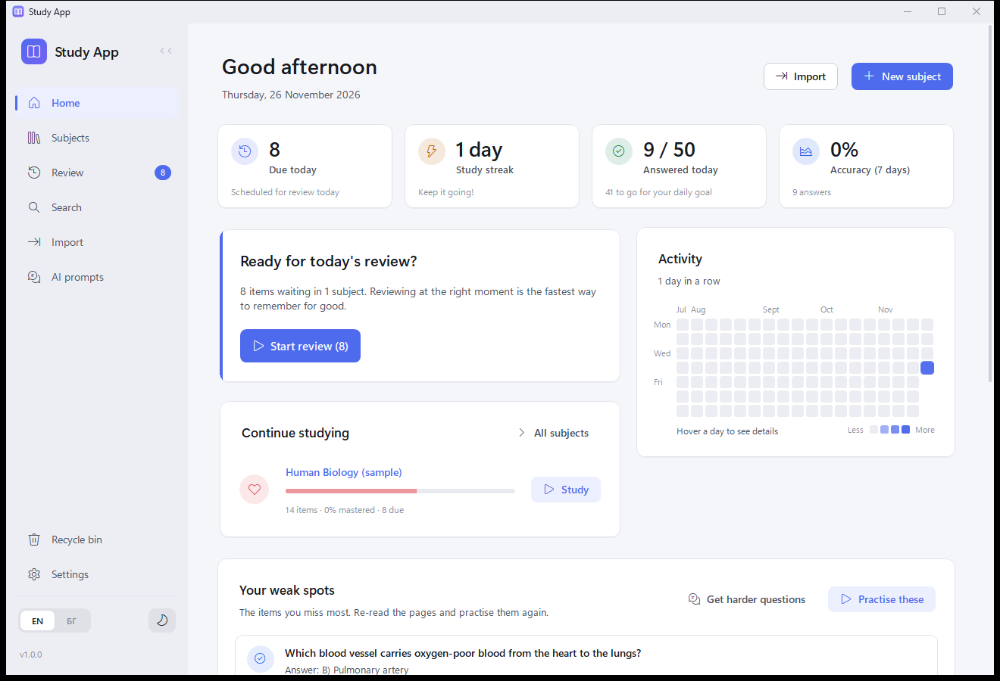
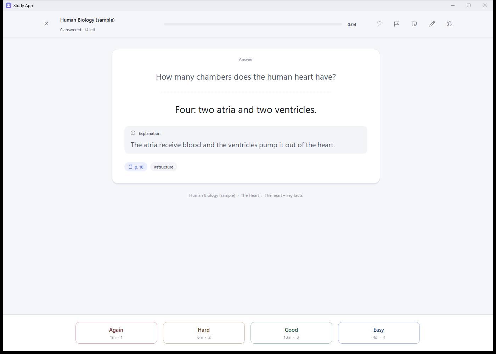
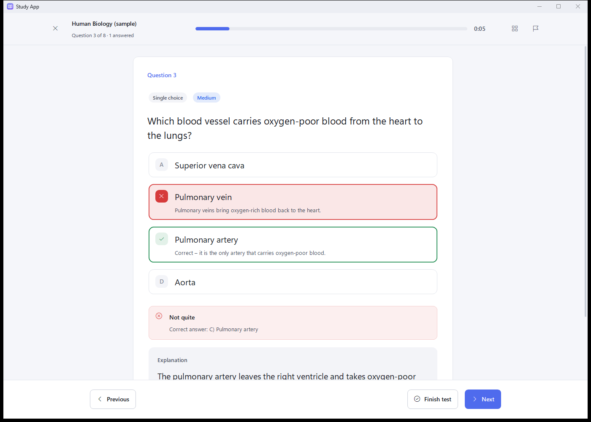
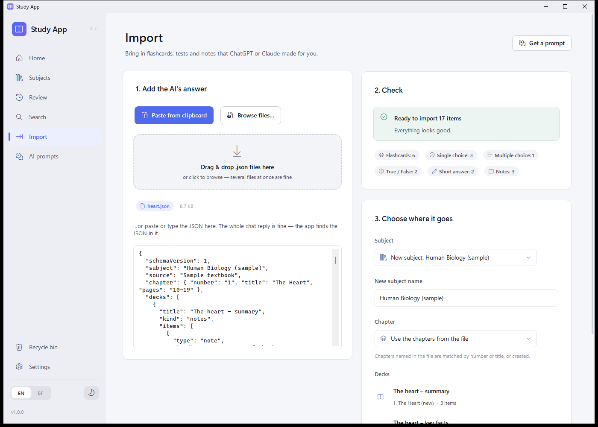
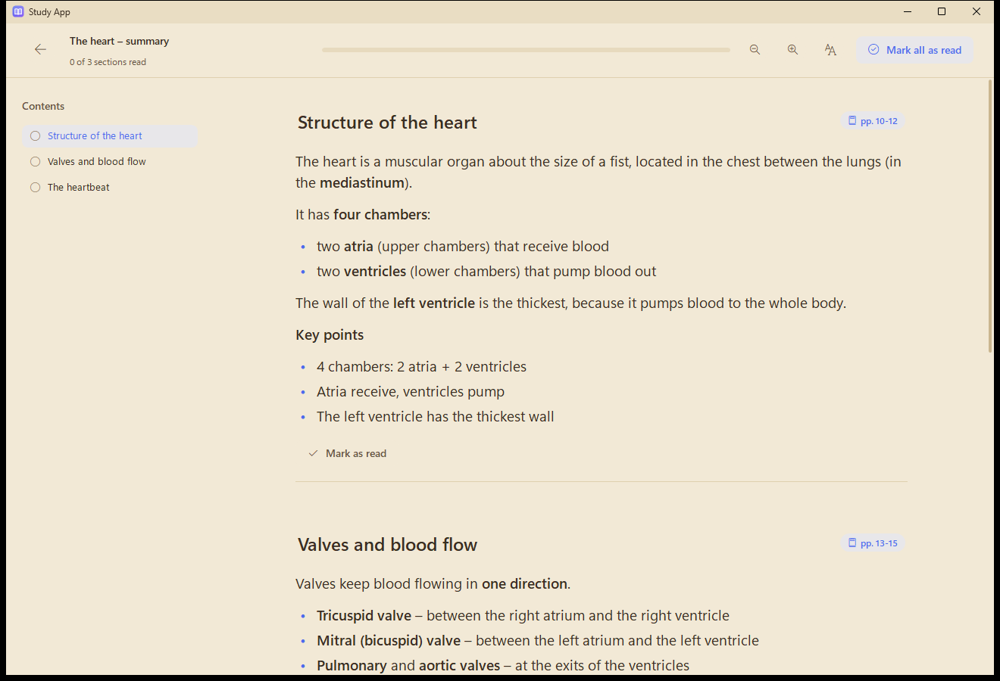
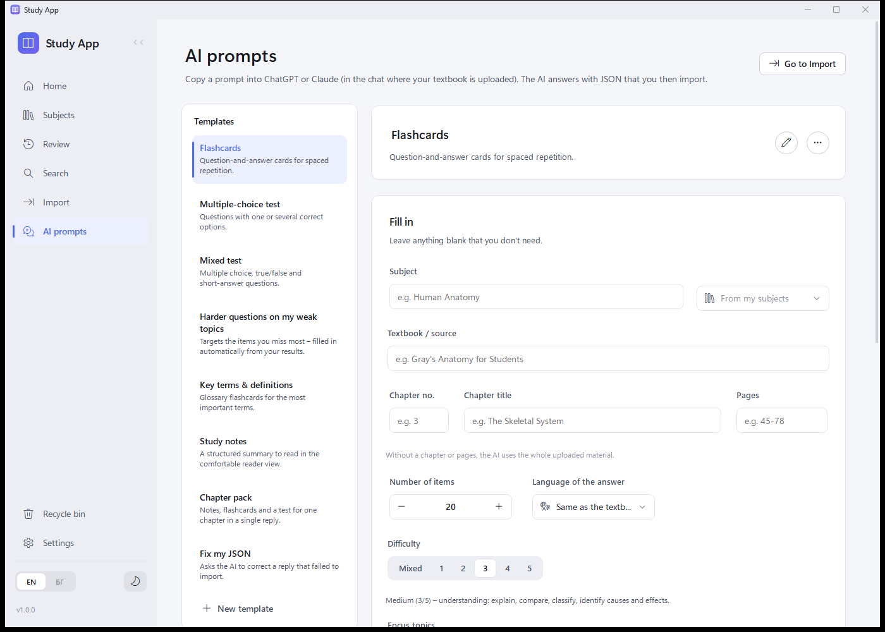
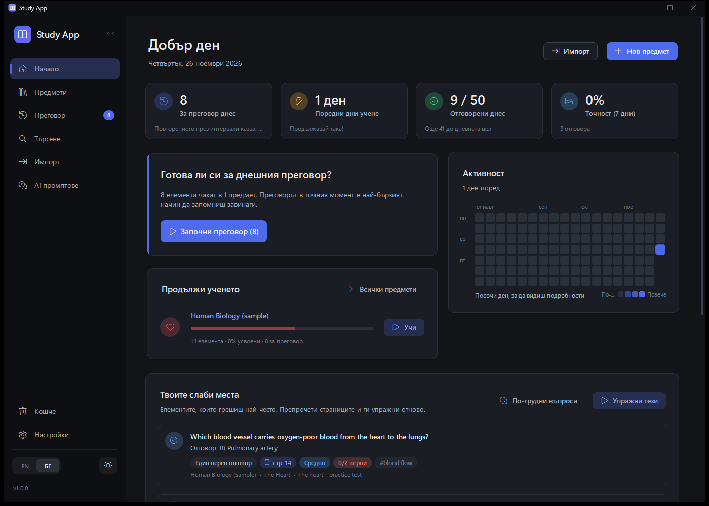

<p align="center"></p>

<h1 align="center">Study App</h1>

<p align="center">
Turn a textbook into flashcards, tests and study notes with ChatGPT or Claude — then learn them with spaced repetition.<br>
<b>English &amp; Български</b> · Windows 10/11 · portable, no installation
</p>

<p align="center"></p>

## How it works

1. **Copy a prompt** from the app (*AI prompts*) into ChatGPT or Claude, in the chat where your textbook is uploaded.
2. The AI answers with **JSON** — flashcards, questions or notes, each with **page references** and **explanations**.
3. **Import** it (paste, browse or drag & drop) and study: flashcards with spaced repetition, tests, and a reader for notes.

## Features

- **Subjects → chapters → decks**, colour and icon per subject, archive, recycle bin with undo
- **Import** from clipboard, files or drag & drop — with preview, readable errors, duplicate detection (skip / replace / keep both),
  and repair of typical AI mistakes (code fences, trailing commas, cut-off replies…)
- **AI prompt templates** (EN + BG): flashcards, multiple-choice / mixed tests, harder questions on *your* weak spots,
  key terms, study notes, chapter packs, "fix my JSON" — editable, with reset to default
- **Flashcards** with SM-2 spaced repetition (Again / Hard / Good / Easy), hints, flip animation, undo
- **Tests**: single/multiple choice, true/false, short answers (self-graded), timer, feedback now or at the end,
  results with **pages to re-read**, "review missed now", "ask AI to explain"
- **Study notes reader** with contents, read tracking and adjustable typography
- **Statistics**: streak, activity calendar, accuracy over time, mastered vs learning, weakest chapters and topics
- **Reading comfort**: light / dark / **sepia** themes, accent colours, fonts, text sizes, line spacing, text width, live preview
- Edit any item, flag it, add personal notes, or mark it **"wrong in source"**
- Global search, keyboard shortcuts everywhere (F1), automatic backups, restore, export to JSON
- **Updates from GitHub Releases** inside the app — the data folder is never touched

| | |
|---|---|
|  |  |
|  |  |
|  |  |

## Download

Get the latest `StudyApp-…-win-x64.zip` from **[Releases](https://github.com/mugen89/Study-app/releases/latest)**,
unzip it (e.g. into *Documents*), and run `StudyApp.exe`. No installation and no .NET needed.
All data stays in the `data` folder next to the app.

## Documentation

- 📘 [User guide (English)](docs/USER-GUIDE.md) · [Ръководство (Български)](docs/USER-GUIDE.bg.md)
- 🧩 [JSON format](docs/json-format.md) · [JSON Schema](docs/studyapp.schema.json) · [Samples](samples/)
- 🛠️ [Developer guide](docs/DEVELOPER.md)

## Development

```powershell
dotnet build StudyApp.sln
dotnet test tests/StudyApp.Tests/StudyApp.Tests.csproj
dotnet run --project src/StudyApp.App
```

C# / .NET 10, Windows Forms with a custom theming layer, SQLite (Microsoft.Data.Sqlite).
Releases are built by GitHub Actions when a `v*` tag is pushed. See the [developer guide](docs/DEVELOPER.md).
